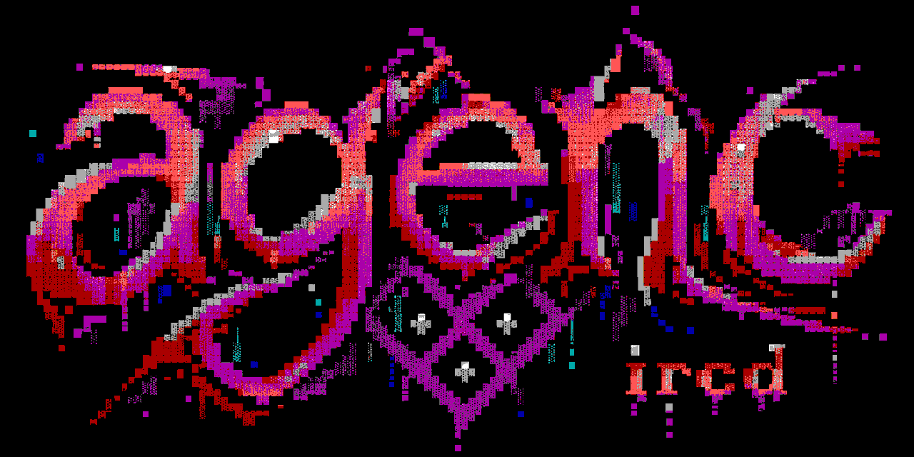

<p align="center">
  
</p>

<p align="center">
  <strong>Familiar chat. Modern trust boundaries.</strong><br>
  A security-first federated chat daemon being built from scratch in safe Rust.
</p>

<p align="center">
  <a href="https://github.com/tetsuo-ai/agenc-ircd/actions/workflows/ci.yml"></a>
  
  
  
</p>

> [!IMPORTANT]
> **This is pre-alpha infrastructure, not a deployable server.** Stages 00
> through 07 are complete. The Stage 04 and Stage 05 checkpoints close exact
> source commit `4040796f2c21774d58ea7ce54e70a080678e83ac`, the Stage 06
> checkpoint closes `65cce9d66f7bcfb0c0830a2ab1d42b52bff82942`, and the Stage
> 07 checkpoint closes `1093d88d0057c3461a423285e0f86ff3775c1140`. The daemon serves
> TLS-only direct, Tor-exit, and onion profiles on one coordinator, and one
> coordinator with authenticated edges over base federation. E2EE and
> WebSocket transports belong to later stages and are not advertised.

## What is being built

The version-1 design keeps nicknames, direct messages, `/join #channel`, topics,
modes, invites, bans, kicks, and public or secret channels while replacing
inherited security assumptions.

| Boundary | Version-1 design |
| --- | --- |
| Transport | TLS 1.3 only; no plaintext listener or STARTTLS downgrade |
| Identity | Pseudonymous accounts separated from nicknames, masks, and network addresses |
| Privacy | Data minimization, no raw-IP logging, direct TLS and Tor onion profiles |
| E2EE | Standard RFC 9420 MLS; servers route opaque ciphertext and never receive epoch secrets |
| Federation | Authenticated coordinator/edge protocol with deterministic recovery semantics |
| Implementation | Safe Rust, bounded queues and parsers, typed state, pinned dependencies, explicit evidence gates |

The project does not invent cryptographic primitives. It defines strict
profiles around maintained implementations of TLS 1.3, OPAQUE, HPKE, MLS,
Ed25519, and authenticated storage.

## Current signal

| Stage | State | Outcome |
| --- | --- | --- |
| 00 | complete; checkpoint closed | Reproducible workspace, source baseline, policy, and traceability |
| 01 | complete; checkpoint closed | 53 registry constants, validated types, 128 canonical object codecs, and independent vectors |
| 02 | complete; checkpoint closed | Incremental framing, client parsing, capability and registration state, bounded rendering, transcripts, and fuzz targets |
| 03 | complete; checkpoint closed | Pure accounts, sessions, channels, authorization, privacy projections, plans, explicit external inputs, and an independent reference model |
| 04 | complete; checkpoint closed | Secret-safe crypto adapters, fixed HPKE and OPAQUE profiles, account authentication, destructive-account proofs, bounded workers, and fuzz coverage |
| 05 | complete; checkpoint closed | Sealed redb records, exact accounting, rollback recovery, bounded checkpoints, full startup reconstruction, signed backup/restore, rekey construction, login-index transition, and native filesystem qualification |
| 06-10 | planned | Runtime composition, federation, E2EE routing, optional profiles, and production qualification |

`agenc-ircd-storage` keeps redb on one blocking owner thread, accepts only
validated owned batches, seals every numbered-table value, and authenticates
nonce reservations, manifests, checkpoints, and the external rollback guard.
Startup opens every record and reconstructs the complete stored domain state
through a disposable on-disk index before the storage port becomes available.
Backup, stopped-daemon restore, rekey, login-index transitions, and bounded
checkpoint work all use resumable authenticated construction records.

Stages 05 through 07 are closed. Stage 06
composes the runtime: strict configuration, first-run initialization, TLS
endpoints, transport-profile isolation, the single StateCore owner,
registration and account sessions, channels and messaging, isolated
administration with an audit chain, atomic live reload, privacy-bounded
observability, and hardened shutdown. Stage 07 adds base federation: mutually
authenticated links with a signed hello, origin lifecycles, idempotent
requests with durable results, least-information projections and events,
acknowledged delivery, snapshots and resume, partition handling, paged
directory queries, and the coordinator and edge roles of the daemon. Stage 08
E2EE is the next implementation stage. The complete dependency-ordered roadmap
lives in [TODO.md](TODO.md). See the
[Stage 07 checkpoint](conformance/evidence/stage-07-1093d88d0057c3461a423285e0f86ff3775c1140.json), the
[Stage 06 checkpoint](conformance/evidence/stage-06-65cce9d66f7bcfb0c0830a2ab1d42b52bff82942.json), the
[Stage 05 storage profile](conformance/stage-five-storage-profile.toml), the
[current Stage 05 checkpoint](conformance/evidence/stage-05-4040796f2c21774d58ea7ce54e70a080678e83ac.json), the
[previous Stage 05 checkpoint](conformance/evidence/stage-05-bd7518fe7f5c7420debdbaa958aa444ecb5c80c9.json), the
[Stage 04 evidence record](conformance/stage-four-evidence.md), the
[current Stage 04 checkpoint](conformance/evidence/stage-04-4040796f2c21774d58ea7ce54e70a080678e83ac.json), the
[previous Stage 04 checkpoint](conformance/evidence/stage-04-1e5b738468f88b238061cc6e84b732176f5cae65.json), the
[historical Stage 04 checkpoint](conformance/evidence/stage-04-8e7236e82ea15e9d3ae6b2a8f01466e32e48feeb.json), and the
[latest CI runs](https://github.com/tetsuo-ai/agenc-ircd/actions).

## Trust shape

```text
 client device
      │  TLS 1.3 or TLS 1.3 inside a Tor onion stream
      ▼
 edge / standalone node ═══ authenticated federation ═══ coordinator
      │                                                        │
      └──────── MLS objects remain opaque to every server ─────┘
```

Tor improves network-location privacy; it does not defeat global timing or
volume correlation. MLS protects encrypted conversation content and group
state; it does not conceal every delivery relationship. The normative
[threat model](docs/ircd-architecture-and-implementation-spec.md#5-threat-and-trust-model)
states the exact guarantees and limits.

## Verify the current stage

The repository pins Rust 1.98.0 and a separate nightly toolchain for fuzz
targets. Install the exact policy and evidence tool versions listed in the
[CI workflow](.github/workflows/ci.yml), then run the implementation checks
from a clean checkout:

```sh
git clone https://github.com/tetsuo-ai/agenc-ircd.git
cd agenc-ircd
bash scripts/check-stage-seven.sh
```

The Stage 05 implementation checks inherit every Stage 00 through 04 command.
They add the closed storage profile, storage integration tests, dependency
evidence for the safe filesystem adapter, and fuzzing for persistent codecs and
authenticated backup streams. The reviewed command list is in
[conformance/gates.toml](conformance/gates.toml).

The reviewed `opaque-ke` patch is vendored, hashed, and checked by workspace
policy. An implementation command alone does not close a stage. Schema version
2 manifests and artifacts close Stages 00 through 03 for exact source commit
`1e5b738468f88b238061cc6e84b732176f5cae65`. Stage 00 has 17 passed records,
Stage 01 has 14, Stage 02 has 12, and Stage 03 has 13. The Stage 04 and
Stage 05 legibility review changed Stage 04 sources, so the
[Stage 04 manifest](conformance/evidence/stage-04-4040796f2c21774d58ea7ce54e70a080678e83ac.json)
with 20 passed records now closes exact source commit
`4040796f2c21774d58ea7ce54e70a080678e83ac`; its recorded gate ran 50 commands. The
earlier Stage 04 manifest for `1e5b738468f88b238061cc6e84b732176f5cae65` and the
schema version 1 records for commit
`8e7236e82ea15e9d3ae6b2a8f01466e32e48feeb` remain archive-only.

The [Stage 05 manifest](conformance/evidence/stage-05-4040796f2c21774d58ea7ce54e70a080678e83ac.json)
contains 39 passed records and closes exact source commit
`4040796f2c21774d58ea7ce54e70a080678e83ac`. Its recorded gate ran 58 commands.
Coverage is 90.64% of branches and 95.65% of lines, with all six critical
regions at 100%. The earlier Stage 05 manifest for
`bd7518fe7f5c7420debdbaa958aa444ecb5c80c9` remains archive-only. The gate
includes 191 storage tests, cross-target checks for
x86_64 and AArch64, signed native ext4 growth reports for both targets, and
10,000 deterministic runs of each storage fuzz target.

The [Stage 06 manifest](conformance/evidence/stage-06-65cce9d66f7bcfb0c0830a2ab1d42b52bff82942.json)
contains 55 passed records and closes exact source commit
`65cce9d66f7bcfb0c0830a2ab1d42b52bff82942`. Its recorded gate ran 75 commands.
Coverage is 79.79% of branches and 91.79% of lines against the interim 75%
branch floor, with all six critical regions at 100%. The gate includes the
Stage 06 requirement set, cross-target checks for x86_64 and AArch64, Loom
models, 16 transcripts, the deterministic soak, deployment and host
qualification checks, and 10,000 deterministic runs of each Stage 06 fuzz
target.

The [Stage 07 manifest](conformance/evidence/stage-07-1093d88d0057c3461a423285e0f86ff3775c1140.json)
contains 38 passed records and closes exact source commit
`1093d88d0057c3461a423285e0f86ff3775c1140`. Its recorded gate ran 85 commands. Coverage is
77.31% of branches and 90.73% of lines against the interim 75% branch floor,
with all six critical regions at 100%. The gate adds the Stage 07 requirement
set, the federated-v1 profile, the transcript catalog over every federation
layer, the bounded federation model, the three-process daemon test, and
10,000 deterministic runs of each federation fuzz target to the inherited
Stage 06 checks.

The binary starts the node with `agenc-ircd serve --config <file>` after
`agenc-ircd init` created the layout and `agenc-ircd check-config` verified the
host controls. Every command fails closed on a configuration, secret, or host
problem; see [docs/operator-guide.md](docs/operator-guide.md).

## Find your way around

| Path | Purpose |
| --- | --- |
| [Architecture specification](docs/ircd-architecture-and-implementation-spec.md) | Base behavior, state ownership, federation, storage, concurrency, security, and release requirements |
| [E2EE companion](docs/irc-mls-e2ee-extension.md) | MLS identity, objects, ordering, downgrade resistance, and encrypted routes |
| [Protocol decision ledger](docs/protocol-sources-and-decisions.md) | Adopted, narrowed, superseded, and pinned standards |
| [`crates/`](crates) | Thirteen-crate Rust workspace with enforced dependency boundaries |
| [`agenc-ircd-domain`](crates/agenc-ircd-domain) | Pure Stage 03 state, command, decision, event, and projection model |
| [`agenc-ircd-crypto`](crates/agenc-ircd-crypto) | Stage 04 secret, entropy, hash, AEAD, signature, HPKE, and bounded-worker adapters |
| [`agenc-ircd-auth`](crates/agenc-ircd-auth) | Stage 04 account-service wire, OPAQUE, creation, login, credential, and deletion state machines |
| [`agenc-ircd-storage`](crates/agenc-ircd-storage) | Stage 05 redb ownership, sealed records, durable transactions, recovery, backup, and construction codecs |
| [`agenc-ircd-testkit`](crates/agenc-ircd-testkit) | Independent models, deterministic inputs, fixtures, and transcript support |
| [`conformance/`](conformance) | Requirement ledger, evidence catalog, gates, and source policy |
| [`test-data/`](test-data) | Deterministic vectors, transcripts, generated property cases, fuzz seeds, and reserved later-stage fixtures |

## Participate

Read [CONTRIBUTING.md](CONTRIBUTING.md) before proposing code or specification
changes. Security findings belong in the private process described by
[SECURITY.md](SECURITY.md), never in a public issue.

No software license has been selected yet. Until a `LICENSE` file is added,
this repository is not offered under an open-source license.
