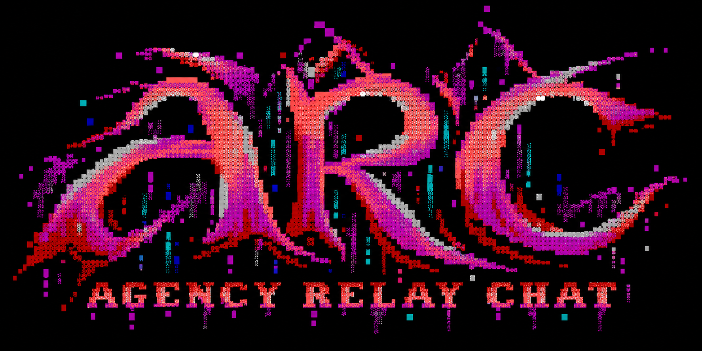

<p align="center">
  
</p>

<p align="center">
  <strong>AgenC Relay (ARCD) powers AgenC Relay Chat (ARC).</strong><br>
  A security-first federated chat relay built in safe Rust.
</p>

<p align="center">
  <a href="https://github.com/tetsuo-ai/agenc-relay-server/actions/workflows/ci.yml"></a>
  
  
  
</p>

## Status

AgenC Relay is the server for AgenC Relay Chat (ARC). **ARCD** is the daemon;
`arcd` is its sole executable. This is private, pre-alpha infrastructure.
Production qualification is incomplete; no release decision has been signed.

The `1.0.0-rc.3` development baseline uses ARC protocol labels and storage
schema generation 5. Initialize fresh development data. Earlier development
profiles and databases are rejected. See the [naming RFC](docs/rfcs/agenc-relay-naming.md)
and [storage baseline](docs/storage-schema-generation-5.md).

| Repository | Responsibility |
| --- | --- |
| [agenc-relay-server](https://github.com/tetsuo-ai/agenc-relay-server) | Server, protocol specifications, and conformance fixtures |
| [agenc-relay-sdk](https://github.com/tetsuo-ai/agenc-relay-sdk) | Shared Rust engine for CLI and GUI consumers; currently a scaffold with an SDK implementation charter |
| [agenc-relay-chat](https://github.com/tetsuo-ai/agenc-relay-chat) | Terminal and desktop application interfaces; currently repository setup |

The server implements accounts, channels, authenticated coordinator/edge
federation, opaque MLS delivery, administration, durable storage and recovery,
and optional WebSocket transport and plaintext channel history. The SDK and
chat application do not yet implement working clients.

## What is being built

The version-1 design keeps nicknames, direct messages, `/join #channel`, topics,
modes, invites, bans, kicks, and public or secret channels while replacing
inherited security assumptions.

| Boundary | Version-1 design |
| --- | --- |
| Transport | TLS 1.3 only; no plaintext listener or STARTTLS downgrade |
| Identity | Pseudonymous accounts separated from nicknames, masks, and network addresses |
| Privacy | Data minimization, no raw-IP logging, direct TLS and Tor onion profiles |
| E2EE | Standard RFC 9420 MLS; servers route opaque ciphertext and never receive epoch secrets |
| Federation | Authenticated coordinator/edge protocol with deterministic recovery semantics |
| Implementation | Safe Rust, bounded queues and parsers, typed state, pinned dependencies, explicit evidence gates |

The project does not invent cryptographic primitives. It defines strict
profiles around maintained implementations of TLS 1.3, OPAQUE, HPKE, MLS,
Ed25519, and authenticated storage.

## Trust shape

```text
 client device
      │  TLS 1.3 or TLS 1.3 inside a Tor onion stream
      ▼
 edge / standalone node ═══ authenticated federation ═══ coordinator
      │                                                        │
      └──────── MLS objects remain opaque to every server ─────┘
```

Tor improves network-location privacy; it does not defeat global timing or
volume correlation. MLS protects encrypted conversation content and group
state; it does not conceal every delivery relationship. The normative
[threat model](docs/arc-architecture-and-implementation-spec.md#5-threat-and-trust-model)
states the exact guarantees and limits.

## Build and verify

Use the pinned Rust toolchain and the prerequisites in the
[CI workflow](.github/workflows/ci.yml).

```sh
git clone https://github.com/tetsuo-ai/agenc-relay-server.git
cd agenc-relay-server
cargo build --workspace --all-features --locked
cargo test --workspace --all-features --locked
bash scripts/check-stage-nine.sh
```

The Stage 09 gate includes the Stage 00–08 gates, cross-target checks,
protocol fixtures, coverage, fuzzing, deployment qualification, and the
optional-feature matrix. Commands are defined in
[conformance/gates.toml](conformance/gates.toml).

Previous stage closures apply only to their recorded source commits. They
are retained in [Git history](https://github.com/tetsuo-ai/agenc-relay-server/tree/1578b639b0aa6a42fececdc9752ab3f258a9ac61/conformance/evidence).
They do not qualify the ARC baseline. Current evidence must be generated by
passing the gates at the exact source revision under test; see the
[evidence procedure](conformance/evidence/README.md).

## Run ARCD

Follow the [operator guide](docs/operator-guide.md) to initialize keys,
configuration, certificates, and host controls. The standard layout is
`/etc/arcd`, `/var/lib/arcd`, `/run/arcd`, and `/var/lib/arcd-operator`.

```sh
cargo run -p agenc-relay-server --bin arcd --locked -- --help
arcd init --help
arcd check-config --config /etc/arcd/config.toml
arcd serve --config /etc/arcd/config.toml
```

Use the configuration path emitted by `init` if you select a custom layout.
Deployment templates are in [deploy/](deploy). Optional transport and history
settings are covered by the [operating instructions](docs/stage-09-operations.md).

## Find your way around

| Path | Purpose |
| --- | --- |
| [Architecture specification](docs/arc-architecture-and-implementation-spec.md) | Base behavior, state ownership, federation, storage, concurrency, security, and release requirements |
| [E2EE companion](docs/arc-mls-e2ee-extension.md) | MLS identity, objects, ordering, downgrade resistance, and encrypted routes |
| [Protocol decision ledger](docs/protocol-sources-and-decisions.md) | Adopted, narrowed, superseded, and pinned standards |
| [`crates/`](crates) | Thirteen-crate Rust workspace with enforced dependency boundaries |
| [`agenc-relay-domain`](crates/agenc-relay-domain) | Pure Stage 03 state, command, decision, event, and projection model |
| [`agenc-relay-crypto`](crates/agenc-relay-crypto) | Stage 04 secret, entropy, hash, AEAD, signature, HPKE, and bounded-worker adapters |
| [`agenc-relay-auth`](crates/agenc-relay-auth) | Stage 04 account-service wire, OPAQUE, creation, login, credential, and deletion state machines |
| [`agenc-relay-storage`](crates/agenc-relay-storage) | Stage 05 redb ownership, sealed records, durable transactions, recovery, backup, and construction codecs |
| [`agenc-relay-testkit`](crates/agenc-relay-testkit) | Independent models, deterministic inputs, fixtures, and transcript support |
| [`conformance/`](conformance) | Requirement ledger, evidence catalog, gates, and source policy |
| [`test-data/`](test-data) | Deterministic vectors, transcripts, generated property cases, fuzz seeds, and reserved later-stage fixtures |

## Participate

Read [CONTRIBUTING.md](CONTRIBUTING.md) before proposing code or specification
changes. Security findings belong in the private process described by
[SECURITY.md](SECURITY.md), never in a public issue.

No software license has been selected yet. Until a `LICENSE` file is added,
this repository is not offered under an open-source license.
